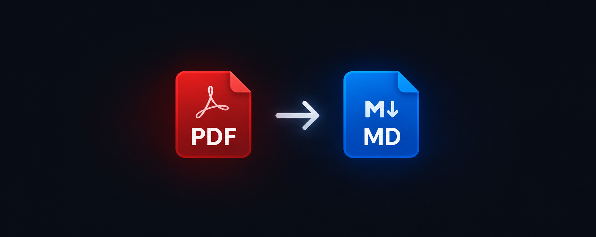

<p align="center">
  
</p>

# PDF to Markdown Converter

A small local application that converts PDF files into Markdown. Select a PDF in
your browser, convert it on your own computer, and download the `.md` file.
Uploaded files are held in a temporary directory only during conversion and are
removed when the request finishes.

## Run the local website

Requirements: Python 3.10 or later.

In PowerShell, from the project folder:

```powershell
py -m venv .venv
.\.venv\Scripts\python.exe -m pip install --upgrade pip
.\.venv\Scripts\python.exe -m pip install -r requirements.txt
.\.venv\Scripts\python.exe app.py
```

Open <http://127.0.0.1:8000>, select a PDF (up to 25 MB), and click **Convert to
Markdown**. The Markdown file downloads through your browser. Press `Ctrl+C` in
PowerShell to stop the server.

The server binds only to `127.0.0.1`; other computers on your network cannot
connect. Do not change this to `0.0.0.0` or expose this development server to
the internet.

## Command-line usage

The converter is also available without the website:

```powershell
.\.venv\Scripts\python.exe convert_pdf.py "C:\path\to\document.pdf"
```

This writes `document.md` next to the source PDF.

## Privacy and limitations

- Conversion is local. The application does not send PDF contents to a cloud
  service or use an external API.
- Each upload is saved under a generated temporary filename and deleted after
  processing. The Markdown download is held in memory for the response.
- Uploads are limited to 25 MB. The app checks the extension, PDF signature,
  and whether the document is password-protected or empty.
- PyMuPDF parses untrusted PDF files. Keep dependencies updated and only open
  files you trust.
- Scanned PDFs may need OCR; this application does not add OCR. Extraction
  quality can vary for complex layouts, tables, and equations.

## Development and tests

Run the tests with Python's built-in unittest runner:

```powershell
.\.venv\Scripts\python.exe -m unittest discover -s tests -v
```

## Git notes

PDF files and generated Markdown files are ignored so that personal documents
and conversion output are not accidentally committed. `README.md` and
`AI_Engineering_Learning_Plan.md` are explicitly kept trackable. Files already
tracked by Git remain tracked regardless of ignore rules.

## Dependencies

- [Flask](https://flask.palletsprojects.com/) — local upload page and download.
- [PyMuPDF4LLM](https://github.com/pymupdf/pymupdf4llm) — PDF-to-Markdown
  extraction, with PyMuPDF installed as a dependency.

The project and dependency licenses are separate. Review the dependency
licenses before redistributing the application.
